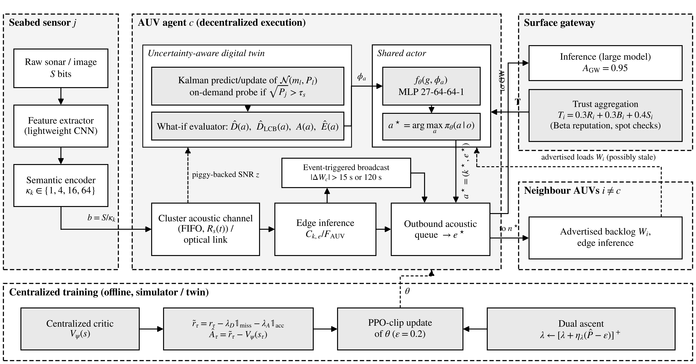
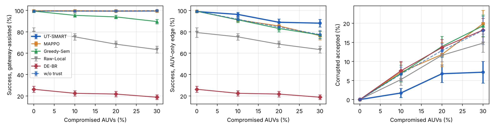

# UT-SMART

**Uncertainty-aware Twin-assisted Semantic Multi-Agent Reinforcement learning with Trust for connected autonomous underwater vehicles (AUVs).**

Reference implementation of the paper:

> M. Shanmuganathan, P. Karthikeyan, A. Aljuhani and A. Jolfaei, "UT-SMART: Uncertainty-Aware Twin-Assisted Semantic Multi-Agent Edge Intelligence for Connected Autonomous Underwater Vehicles," submitted to *IEEE Transactions on Vehicular Technology*.

The repository contains the discrete-time underwater network simulator, the constrained MAPPO learner, all baselines and ablations, the evaluation sweeps, the figure scripts and the LaTeX sources of the paper (`paper/`). It needs only NumPy, SciPy and Matplotlib: the 6k-parameter networks are trained with a small NumPy autograd-free MLP, so no GPU or deep-learning framework is required.

<p align="center"></p>

## What is implemented

| Component | Description | Code |
|---|---|---|
| Acoustic/optical channel | Thorp absorption, Urick noise, AR(1) log-normal shadowing, Markov outages, ARQ goodput, 1 Mb/s optical links within 60 m | `utsmart/channel.py` |
| Network simulator | 3-D sensor field, patrolling AUVs with current drift, FIFO queues with time-varying rates, propagation delay, deadline drops, three missions, compromised AUVs | `utsmart/env.py` |
| Semantic in-network computing | Four sensor-side compression levels (1×, 4×, 16×, 64×) with encoder cost and mission-dependent accuracy loss | `utsmart/env.py` |
| Uncertainty-aware digital twin | Per-AUV Kalman posteriors over link shadowing, on-demand probing, mean and LCB what-if predictions for all 12 actions | `utsmart/twin.py`, `env._whatif` |
| Trust | Beta reputation (reliability, behavioural consistency, spot-checked results) used inside the policy | `utsmart/trust.py` |
| Constrained MAPPO | Parameter-shared action scorer, centralized critic, PPO-clip, Lagrangian dual ascent, domain randomization | `utsmart/policies.py`, `utsmart/mappo.py` |
| Event-triggered sharing | AUV load broadcast when the load changes by more than 15 s or on a 120 s heartbeat | `env._state_sharing` |
| Baselines | Raw-Local, DE-BR (delay–energy best response), Greedy-Sem, MAPPO, plus five ablations | `utsmart/policies.py`, `utsmart/config.py` |

[`docs/IMPLEMENTATION.md`](docs/IMPLEMENTATION.md) maps every equation in the paper to the code. It also lists the modelling choices the paper leaves open.

## Quick start

```bash
git clone https://github.com/<your-account>/ut-smart.git
cd ut-smart
python -m venv .venv && source .venv/bin/activate
pip install -e ".[dev]"
pytest -q                                  # 23 tests, a few seconds
```

Run one episode:

```python
import numpy as np
from utsmart import SimConfig, VARIANTS, UnderwaterEnv
from utsmart.policies import make_policy

cfg = SimConfig(n_sensors=100, n_auvs=5, gateway_compute=True)
v = VARIANTS["greedy_sem"]
print(UnderwaterEnv(cfg, v, make_policy(v, None), seed=0).run())
```

## Reproducing the paper

```bash
# 1) train 7 learned variants x 3 seeds x 600 episodes  (~30 min on 2 cores; ~2.7 min per run)
python scripts/train.py --variants all --seeds 0 1 2

# 2) run all sweeps, 10 evaluation seeds disjoint from the training seeds  (~2 min)
python scripts/evaluate.py --seeds 10

# 3) figures/*.png, results/summary.md, results/ablation.md (95% CIs, paired t-tests)
python scripts/make_figures.py
```

Or run everything with `bash scripts/run_all.sh`. `QUICK=1 bash scripts/run_all.sh` is a three-minute smoke version.

| Script | Output | Paper |
|---|---|---|
| `train.py` | `models/*.npz`, `results/train/*.csv` | Fig. 2 (convergence) |
| `evaluate.py --sweeps sensors` | `results/sensors.csv` | Fig. 3 |
| `evaluate.py --sweeps auvs` | `results/auvs.csv` | Fig. 4 |
| `evaluate.py --sweeps channel` | `results/channel.csv` | Fig. 5 |
| `evaluate.py --sweeps attack` | `results/attack.csv` | Fig. 6 |
| `evaluate.py --sweeps sync` | `results/sync.csv` | Fig. 7 |
| `evaluate.py --sweeps ablation` | `results/ablation.csv` → `ablation.md` | Table IV |

Methods: `utsmart`, `mappo`, `greedy_sem`, `debr`, `raw_local` and the ablations `wo_uncertainty`, `wo_ondemand`, `wo_trust`, `wo_event` and `wo_semantic`. All parameters live in `SimConfig` (`utsmart/config.py`). Override them with `cfg.with_(shadow_sigma=6.0, malicious_frac=0.3)`.

## Results from this code

The trained models, per-seed CSVs and figures in this repository come from a single run of the three commands above. All values are means over 10 evaluation seeds, with 95% CIs where shown.

**Default point** (M = 100, N = 5, σ = 4 dB, one compromised AUV, gateway-assisted):

| Method | Success (%) | Miss (%) | Below A_min (%) | Corrupted (%) | Delay (s) | Energy (J) | Traffic (kbit) | Control (kbit) | Twin RMSE (dB) |
|---|---|---|---|---|---|---|---|---|---|
| UT-SMART | 99.3 ± 0.6 | 0.74 | 0.00 | 0.00 | 14.51 | 19.99 | 37.31 | 0.68 | 1.65 |
| MAPPO | 99.9 ± 0.2 | 0.12 | 0.00 | 0.00 | 12.69 | 19.05 | 41.97 | 7.41 | 3.10 |
| Greedy-Sem | 94.0 ± 2.1 | 1.18 | 0.00 | 4.85 | 14.52 | 17.03 | 48.51 | 7.82 | 3.16 |
| Raw-Local | 42.1 ± 3.1 | 51.59 | 0.00 | 6.31 | 209.75 | 69.03 | 255.84 | 10.31 | 3.10 |
| DE-BR | 21.6 ± 1.8 | 1.94 | 74.47 | 13.51 | 8.57 | 4.83 | 18.33 | 8.49 | 3.17 |

**Ablation** (N = 5, M = 100, one compromised AUV):

| Variant | Success, gateway (%) | Success, AUV-only (%) | p vs UT-SMART (AUV-only) | Corrupted, AUV-only (%) | Control (kbit/task) | Twin RMSE (dB) | Energy, AUV-only (J/task) |
|---|---|---|---|---|---|---|---|
| UT-SMART | 99.3 ± 0.6 | 94.2 ± 1.8 | — | 2.4 | 0.68 | 1.65 | 32.3 |
| w/o uncertainty | 99.5 ± 0.4 | 89.6 ± 4.9 | 0.0546 | 6.0 | 7.08 | 3.13 | 27.6 |
| w/o on-demand sync | 99.8 ± 0.3 | 91.8 ± 3.0 | 0.0743 | 4.0 | 6.96 | 3.03 | 29.2 |
| w/o trust | 99.6 ± 0.5 | 84.8 ± 2.6 | 1.5e-05 | 12.1 | 0.67 | 1.51 | 22.3 |
| w/o event-triggered sharing | 99.7 ± 0.3 | 91.5 ± 2.9 | 0.0835 | 4.2 | 1.32 | 1.50 | 30.3 |
| w/o semantic computing | 45.1 ± 2.6 | 44.6 ± 3.2 | 1.28e-11 | 4.1 | 0.72 | 1.76 | 73.1 |
| MAPPO | 99.9 ± 0.2 | 85.3 ± 2.7 | 7.59e-06 | 11.0 | 7.41 | 3.10 | 22.7 |

<p align="center"></p>

The qualitative findings of the paper hold. Semantic compression is necessary in every setting. When a gateway is available, UT-SMART matches MAPPO's success with about 90% less control traffic and about half the twin error. At the AUV-only edge, trust-aware assignment adds about 9 points of success over MAPPO (p < 10⁻⁵) and cuts accepted corrupted results from 11% to 2.4%, at the cost of higher energy per task. Exact numbers differ from the manuscript by a few points, because the paper leaves some modelling details open (listed in `docs/IMPLEMENTATION.md`) and because results depend on random seeds. **Update the manuscript's numbers from `results/` before submission if you adopt this code as the reference implementation.**

## Repository layout

```
utsmart/            simulator, twin, trust, policies, constrained MAPPO, sweeps
scripts/            train.py, evaluate.py, make_figures.py, run_all.sh
models/             trained actors and critics (7 variants x 3 seeds, .npz)
results/            per-seed CSVs, training logs, summary/ablation tables
figures/            generated figures
paper/              LaTeX sources and figures of the manuscript
tests/              pytest suite (channel, twin/trust, env, gradient check, training round-trip)
docs/               paper-to-code map and modelling notes
```

## Citation

See `CITATION.cff`. Until the paper is published, please cite the manuscript as above.

## License

MIT. See `LICENSE`. `paper/IEEEtran.cls` is distributed under the LaTeX Project Public License.
